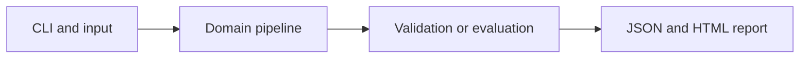

# Microscopy Morphology Under Domain Shift

Measure how a neural morphology classifier changes across synthetic acquisition conditions.

**Category:** Biology / Deep Learning

**Execution:** Actual local algorithm or workflow; no external model service required.

## Run

```sh
python -m venv .venv
# Windows: .venv\Scripts\activate
# macOS/Linux: source .venv/bin/activate
python -m pip install -r requirements.txt
python app.py
python -m unittest discover -v
```

Open `results/report.html` after running. Python 3.10+ is required. Use `--help` for input and seed options.

## Architecture



## Algorithm

Use hand-engineered intensity histogram and local-gradient summaries as inputs to a two-layer tanh classifier. Train on bright imaging domains and compare raw versus per-image normalized features on a shifted domain.

## Evaluation

Split entire acquisition domains. Report held-out-domain accuracy for both preprocessing choices with a majority baseline, avoiding pixel-level leakage.

## Limitations

Labels are fictional sparse versus dense patterns, not diseases or diagnoses. Normalization can erase genuine biology and must be assessed on real data.

## Documentation

- [PDF project guide](PROJECT_GUIDE.pdf)
- [Editable guide](GUIDE.md)
- [Model and system card](MODEL_CARD.md)
- [Measured results](results/metrics.json)
- [Test output](TEST_RESULTS.txt)

## Extend it

Use licensed morphology data, specimen-group splits, stain or instrument perturbations, calibration and domain-adaptation baselines.

AI-assisted educational project with synthetic data. Review, customize and explain your own contribution accurately. MIT license.

## Biology scope and current relevance

Default inputs are synthetic or project-authored. No clinical deployment or wet-lab validation is claimed. See [research context](RESEARCH_CONTEXT.md) and [data provenance](DATA_PROVENANCE.md).

- [CellSAM: a foundation model for cell segmentation](https://www.nature.com/articles/s41592-025-02879-w) (2025)
